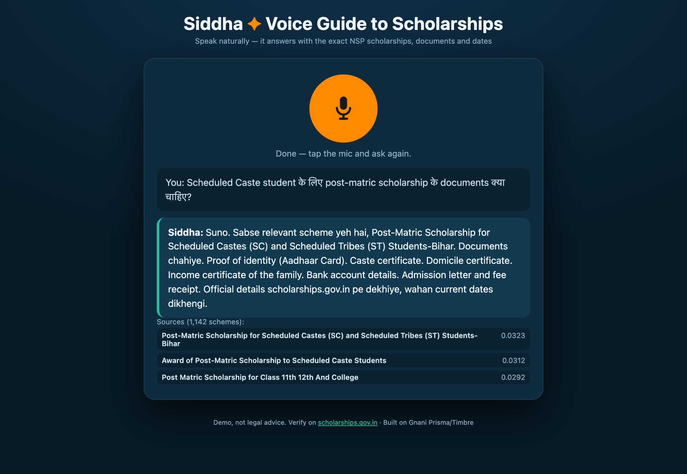

# Siddha
**Voice-first scholarship guide for India — ask in Hinglish, Hindi or Tamil, get the exact NSP scheme, documents and dates, spoken back to you. Powered end-to-end by Gnani's own voice models.**

[](https://github.com/Arunkumar06-cmd/siddha/actions) [](https://github.com/Arunkumar06-cmd/siddha) [](https://www.python.org/) [](./LICENSE) [](#roadmap)



<sub>Real UI, real Gnani Prisma + Timbre call. Architecture diagram: [docs/architecture.md](./docs/architecture.md).</sub>

## Table of contents
- [Features](#features)
- [Quick start](#quick-start)
- [Installation](#installation)
- [Usage](#usage)
- [API reference](#api-reference)
- [Project structure](#project-structure)
- [Contributing](#contributing)
- [Roadmap](#roadmap)
- [License](#license)

## Features
- **Voice-in, voice-out** — browser mic → Prisma STT (`prisma-v3.0`, `indic-auto`, `codemix`) → RAG → Timbre TTS answers in the same language.
- **Grounded answers** — every reply is assembled from myScheme's 1,142 scholarship schemes; the LLM never invents eligibility or dates.
- **Hybrid retrieval** — MiniLM-L12 multilingual embeddings + FAISS + BM25, fused with reciprocal rank fusion (RRF).
- **Hinglish-first** — answers are shaped for Indian code-mixed speech, not translated English.
- **Cost-safe** — one turn = exactly 2 Gnani calls (1 STT + 1 TTS); 5,000 programme credits ≈ 2,500 turns.
- **Crash-safe** — circuit breakers, retry with backoff+jitter, per-IP rate limits, typed errors.

## Quick start
```bash
git clone https://github.com/Arunkumar06-cmd/siddha.git
cd siddha
python3 -m venv .venv && source .venv/bin/activate
pip install -r requirements.txt   # ~10 min on CPU torch
python -m uvicorn server:app --host 127.0.0.1 --port 8765
```
Open http://127.0.0.1:8765 — tap the mic, ask in Hinglish.

## Installation
**Prerequisites:** Python 3.11+, macOS/Linux, ffmpeg on PATH, ~2 GB free disk (CPU torch), a valid `GNANI_API_KEY` from [app.gnani.ai](https://app.gnani.ai/).

```bash
pip install --extra-index-url https://download.pytorch.org/whl/cpu -r requirements.txt
```

Environment variables (put in `~/.env` locally; never commit):

| Variable | Required | Description | Default |
|---|---|---|---|
| `GNANI_API_KEY` | yes | Key from app.gnani.ai → API keys (scope: `STT`, `TTS`) | — |
| `SIDDHA_HOST` | no | Bind address (`0.0.0.0` exposes the LAN) | `127.0.0.1` |
| `SIDDHA_PORT` | no | Port | `8765` |
| `SIDDHA_RATE_LIMIT` | no | Requests per minute per IP | `30` |

## Usage

Text question via curl (no mic needed):

```bash
curl -s -X POST http://127.0.0.1:8765/api/ask_text \
  -H 'Content-Type: application/json' \
  -d '{"text":"scholarship ke liye kaunse documents chahiye"}'
```

Voice question via MediaRecorder POST (see `static/index.html`):

```bash
curl -s -X POST http://127.0.0.1:8765/api/ask_audio \
  -F 'audio=@question.wav;type=audio/wav'
```

```diff
+ The response contains transcript, reply, sources[], and audio_wav_b64 (base64 WAV).
```

## API reference

| Endpoint | Method | Purpose | Body |
|---|---|---|---|
| `/api/ask_text` | POST | RAG answer | `{"text": "..."}` (2–500 chars) |
| `/api/ask_audio` | POST | Voice STT→RAG→TTS | multipart `audio` ≤ 8 MB |
| `/api/health` | GET | Liveness + corpus check (503 if degraded) | — |
| `/api/metrics` | GET | Counters + circuit state | — |

## Project structure
```
.
├── server.py            # thin routes layer (FastAPI)
├── src/
│   ├── pipeline.py      # mic→ffmpeg→Prisma→RAG→Timbre (testable core)
│   ├── retriever.py     # FAISS + BM25 + RRF over myScheme corpus
│   ├── responder.py     # grounded answer composition
│   ├── spoken.py        # voice-safe prose (<pauses> for Timbre v3)
│   ├── resilience.py    # circuit breakers + retry/backoff
│   ├── config.py        # typed env config + logging
│   └── prepare_corpus.py / build_index.py  # offline corpus tools
├── static/index.html    # mic UI
├── data/scholarships.jsonl   # 1,142 schemes (extracted from myScheme)
├── data/scholarships.faiss   # prebuilt FAISS index
├── specs/NFR.md         # non-functional requirements (explicit)
├── tests/               # 36 tests, 85% coverage
├── docs/                # screenshot, architecture, ADRs, API
└── .github/workflows/   # CI + security
```

<details><summary>Advanced: self-host a public demo</summary>

Any Docker host works. For Hugging Face Spaces (free):
1. Create a Space → SDK: Docker.
2. Add repo as remote.
3. Space → Settings → **Secrets**: `GNANI_API_KEY`.
4. The Space runs on port 7860 (Dockerfile default). `/api/health` must be green.

Everything (model pre-download, healthcheck, non-root user) is baked in — no manual steps beyond the secret.
</details>

## Contributing
Fork → branch → `make lint test` → PR → CI green → 1 review. See [CONTRIBUTING.md](./CONTRIBUTING.md).

## Roadmap
- **v2.2** — LLM-composed phrasing (grounded; opt-in via API key), streaming TTS via SSE/WS
- **v2.3** — Eligibility-aware ranking (age/income/category parsing from voice)
- **v2.4** — Multi-turn conversation memory; application progress tracking
- **v3.0** — Voice-based form filling (auto-populate NSP fields from speech)

## License
MIT — see [LICENSE](./LICENSE).

*Built with FastAPI, Gnani Prisma/Timbre and FAISS by Arunkumar Karumbayiram.*
