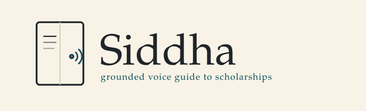
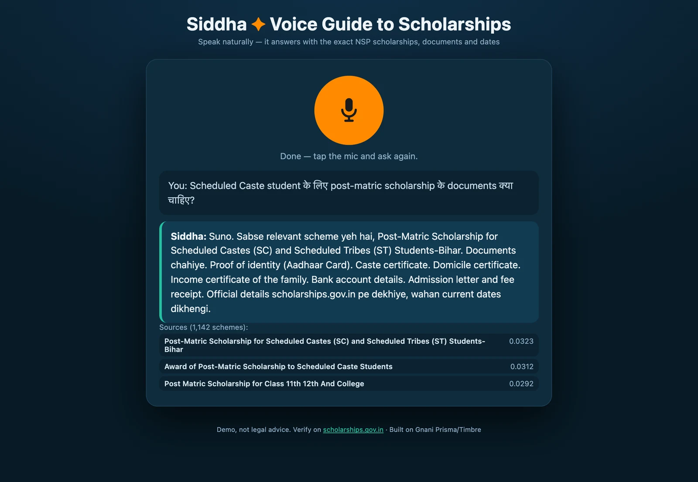
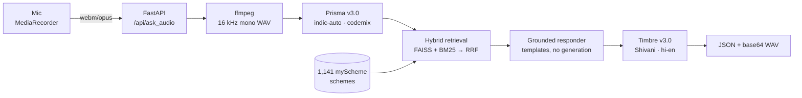

<p align="center">
  
</p>

<p align="center">
  <b>A voice-first scholarship guide for India.</b><br/>
  Ask in Hinglish, Hindi or Tamil. Get the matching scheme, the documents it lists, and where to check the current deadline. Answers are spoken in Hinglish.<br/>
  Grounded in 1,141 official myScheme records. Powered by Gnani Prisma (speech-to-text) and Timbre (text-to-speech).
</p>

<p align="center">
  <a href="https://github.com/Arunkumar06-cmd/siddha/actions"></a>
  <a href="https://www.python.org/"></a>
  <a href="./LICENSE"></a>
  <a href="#roadmap"></a>
</p>

> [!IMPORTANT]
> **Grounded, or silent.** Every statement about a scheme comes from that scheme's myScheme record. If the record has no deadline, amount, or document list, Siddha says the record is silent and points to the official page. Rules are read in full or sent to the official page, never cut mid-condition.



<p align="center">
  <a href="https://arunkumar06-cmd.github.io/siddha/"><b>▶ Watch the 2-minute demo (streams inline)</b></a>
  &nbsp;·&nbsp;
  <a href="./docs/demo.mp4">Download master</a>
  &nbsp;·&nbsp;
  <a href="./docs/architecture.md">Architecture</a>
  &nbsp;·&nbsp;
  <a href="https://scholarships.gov.in/">Official scholarship portal</a>
  <br/>
  <sub>Real UI, two live Gnani Prisma + Timbre turns; the second is a follow-up with no scheme name repeated.</sub>
</p>

## Table of contents
- [Features](#features)
- [Quick start](#quick-start)
- [Installation](#installation)
- [Usage](#usage)
- [API reference](#api-reference)
- [Project structure](#project-structure)
- [Contributing](#contributing)
- [Roadmap](#roadmap)
- [License](#license)

## Features
- **Voice in, voice out.** Browser mic → Prisma STT → retrieval → Timbre TTS. No chat box required.
- **Grounded answers.** Each answer is built from 1,141 official myScheme records. If a fact is not in the record, Siddha says so. The UI shows the sources it used. Status and renewal questions are answered only from what the record says; there is no hard-coded portal flow.
- **Follow-ups keep context.** A follow-up like “Aur last date kya hai?” is resolved against the scheme already on the table. A new scheme name or a new state retrieves fresh results. Sessions are text-only, in-memory, and expire after 30 minutes. The UI shows the carried scheme, so context is visible.
- **State-aware routing.** A state-specific question gets that state's schemes first; a national question gets Central schemes. When a State scheme is chosen for a state-less query, Siddha names the state.
- **Eligibility questions.** Ask "qualify hun kya?" and Siddha checks your profile against the record text, then includes the line it matched. This is opt-in: it runs only when an OpenAI-compatible endpoint is configured. With that setting, the question text (which may include income or category) is sent to that provider. Without a key, nothing leaves the server except the Gnani STT/TTS calls, and the grounded path answers unchanged.
- **Call-quality audio probe.** A small probe (n = 12 code-mixed utterances, 8 kHz band-passed telephony with traffic and fan noise): Prisma transcribes all 12; 11/12 keep every critical term (`docs/eval-audio.md`). It shows the idea works; it is not a benchmark.
- **Hindi and Tamil input.** A Tamil-script question is transcribed with `detected_language_code=ta-IN`, and Devanagari/Tamil follow-ups use the same context rules. The spoken answer is Hinglish for now (see Known limitations).
- **Hybrid retrieval.** BGE-M3 multilingual embeddings handle semantic matches, BM25 handles exact keywords, and the results are fused with reciprocal rank fusion.
- **Hinglish-first replies.** Answers are written for Indian code-mixed speech, not translated English.
- **Cheap to run.** One turn = exactly 2 Gnani calls (one STT, one TTS). Roughly 2,500 full voice turns per 5,000 programme credits, with a hard global and per-visitor budget enforced before each provider call.
- **Fails soft.** Circuit breakers with a single half-open probe, retry with backoff and jitter that resends the whole upload, per-IP rate limits, typed errors, and a text-only reply if voice synthesis is down.

## Quick start
```bash
git clone https://github.com/Arunkumar06-cmd/siddha.git
cd siddha
python3 -m venv .venv && source .venv/bin/activate
pip install -r requirements.txt   # ~10 min on CPU torch
python -m uvicorn server:app --host 127.0.0.1 --port 8765
```
Open http://127.0.0.1:8765 — tap the mic, ask in Hinglish.

> [!NOTE]
> `GNANI_API_KEY` must exist in `~/.env` or the environment before startup. It never ships in the repo or the Docker image.

## Installation
**Prerequisites:** Python 3.11+, macOS/Linux, ffmpeg on PATH, ~2 GB free disk (CPU torch), a valid `GNANI_API_KEY` from [app.gnani.ai](https://app.gnani.ai/).

```bash
pip install --index-url https://download.pytorch.org/whl/cpu "torch==2.12.1"   # CPU wheel, as in CI and Docker
pip install -r requirements.txt
```

Environment variables (put in `~/.env` locally; never commit):

| Variable | Required | Description | Default |
|---|---|---|---|
| `GNANI_API_KEY` | yes | Key from app.gnani.ai → API keys (scope: `STT`, `TTS`) | — |
| `SIDDHA_HOST` | no | Bind address (`0.0.0.0` exposes the LAN) | `127.0.0.1` |
| `SIDDHA_PORT` | no | Port | `8765` |
| `SIDDHA_RATE_LIMIT` | no | Requests per minute per IP | `30` |

## Usage

Text question via curl (no mic needed):

```bash
curl -s -X POST http://127.0.0.1:8765/api/ask_text \
  -H 'Content-Type: application/json' \
  -d '{"text":"scholarship ke liye kaunse documents chahiye"}'
```

Voice question via MediaRecorder POST (see `static/index.html`):

```bash
curl -s -X POST http://127.0.0.1:8765/api/ask_audio \
  -F 'audio=@question.wav;type=audio/wav'
```

```diff
+ The response contains transcript, reply, sources[], and audio_wav_b64 (base64 WAV).
```

> [!TIP]
> No microphone? `/api/ask_text` runs the same retrieval and voice synthesis path without STT.

## API reference

| Endpoint | Method | Purpose | Body |
|---|---|---|---|
| `/api/ask_text` | POST | RAG answer | `{"text": "...", "session_id": "...", "speak": false}` (2–500 chars; `speak=false` skips the TTS call) |
| `/api/ask_audio` | POST | Voice STT→RAG→TTS | multipart `audio` ≤ 8 MB + optional `session_id` |
| `/api/session/{id}` | GET | Restore the last turn: transcript, reply, sources, context | — |
| `/api/ready` | GET | Readiness: model + index loaded | — |
| `/metrics` | GET | Prometheus counters + per-stage latency | — |
| `/api/session/{id}` | DELETE | Start a new conversation | — |
| `/api/health` | GET | Liveness + corpus check (503 if degraded) | — |
| `/api/metrics` | GET | Quality counters, credits, circuit state, per-stage latency | — |

## Project structure
```
.
├── server.py            # thin routes layer (FastAPI)
├── src/
│   ├── pipeline.py      # mic→ffmpeg→Prisma→RAG→Timbre (testable core)
│   ├── retriever.py     # FAISS + BM25 + RRF over myScheme corpus
│   ├── responder.py     # grounded answer composition
│   ├── context.py       # deterministic follow-up resolution
│   ├── conversation.py  # session memory (TTL + caps)
│   ├── spoken.py        # voice-safe prose (<pauses> for Timbre v3)
│   ├── resilience.py    # circuit breakers + retry/backoff
│   ├── config.py        # typed env config + logging
│   └── prepare_corpus.py / build_index.py  # offline corpus tools
├── static/index.html    # mic UI
├── data/scholarships.jsonl   # 1,141 schemes (extracted from myScheme)
├── data/scholarships.faiss   # prebuilt FAISS index
├── specs/NFR.md         # non-functional requirements (explicit)
├── tests/               # unit, failure-mode and regression tests
├── docs/                # demo video, screenshot, architecture, ADRs, API
└── .github/workflows/   # CI + security
```

<details>
<summary><b>Architecture</b> — a voice turn, with follow-up context</summary>



A follow-up that names only an aspect (“aur last date?”) is answered from the record already on the table, with no additional retrieval. A follow-up with a new state or category re-retrieves with the previous scheme as an anchor; a new scheme name is treated as a new topic. The rules are deterministic and unit-tested in `tests/test_context.py`.

</details>

<details><summary>Advanced: self-host a public demo</summary>

Any Docker host works. For Hugging Face Spaces (free):
1. Create a Space → SDK: Docker.
2. Add repo as remote.
3. Space → Settings → **Secrets**: `GNANI_API_KEY`.
4. The Space runs on port 7860 (Dockerfile default). `/api/ready` must be green (it turns 200 once the model and index are warm; `/api/health` checks the corpus, key and ffmpeg).

Everything (model pre-download, healthcheck, non-root user) is baked in — no manual steps beyond the secret.
</details>

## Known limitations
Stated up front so nobody has to find them.

- **Answers are Hinglish.** Hindi and Tamil questions are understood, but the reply text and voice (`hi-en`) are always Hinglish templates.
- **Retrieval is measured, not perfect.** On the 30-query hand-written Hinglish set (`scripts/eval_retrieval.py`) recall@1 is **0.733** and recall@5 is **0.767** (95% CI 0.57–0.87 and 0.60–0.90: the set is small). The 1,141-query name set scores 0.999 recall@1, and the 400-query ASR-damaged set scores 0.682 recall@1 / 0.925 recall@5. The confidence gate refuses 30/30 off-topic queries. The state-routing multipliers were set with the hand set in view and there is no held-out split yet, so treat the intent numbers as optimistic. Siddha always answers from the top hit; it does not yet ask "did you mean A or B?" when two schemes are close.
- **Deadlines are not in most records.** Only 60 of the 1,141 records (5.3%) contain a last-date or deadline phrase, and the corpus has no "as of" date. For the rest, the answer to "last date?" is "the record has none, check [scholarships.gov.in](https://scholarships.gov.in/)".
- **Long rules are summarised, not read in full.** Eligibility and benefit text is spoken as whole sentences up to a length budget; the rest is sent to the official page. The voice may cover less than the on-screen text (the API reports `audio_truncated`).
- **Single process, in-memory sessions.** A restart clears conversations. One worker, one machine.
- **Audio may cover less than the text.** Long replies are spoken as whole sentences up to the Timbre cap; the API reports `audio_truncated`.

## Contributing
Fork → branch → `make lint test` → PR → CI green → 1 review. See [CONTRIBUTING.md](./CONTRIBUTING.md).

## Roadmap
- **Shipped (v2.2)** — grounded Hinglish voice loop, BGE-M3 hybrid FAISS + BM25 retrieval, state-aware routing, deterministic follow-up context, 2-minute demo
- **v2.3** — live deadline/status refresh from official sources; eligibility parsing from voice remains
- **v2.4** — opt-in LLM phrasing (grounded in retrieved records, requires a key); streaming TTS
- **v3.0** — voice-based form filling (auto-populate NSP fields from speech)

## License
MIT — see [LICENSE](./LICENSE).

*Built with FastAPI, Gnani Prisma/Timbre and FAISS by Arunkumar Karumbayiram.*
